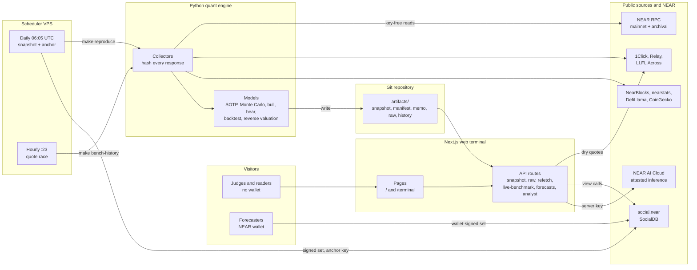
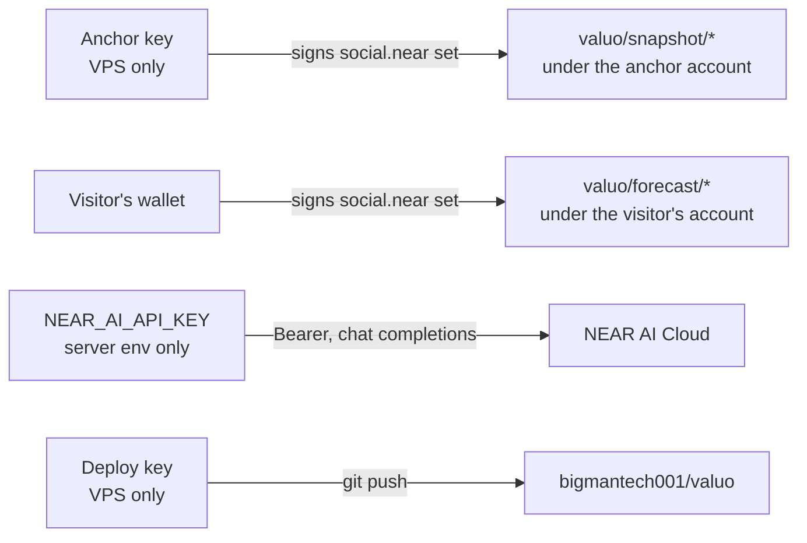
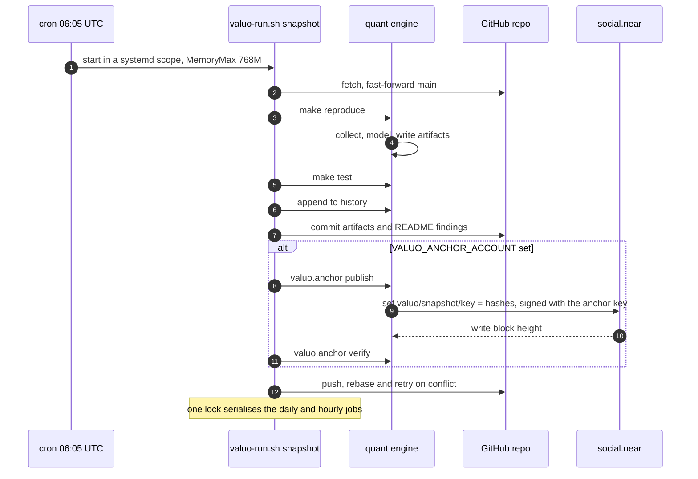
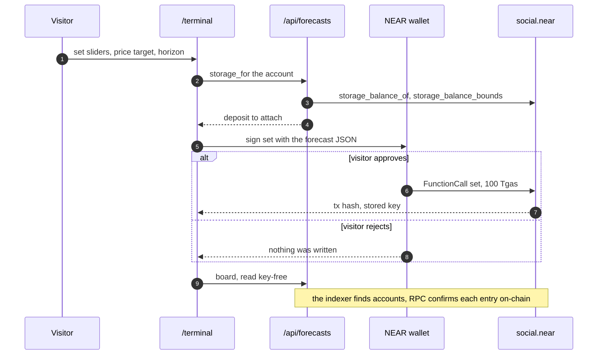
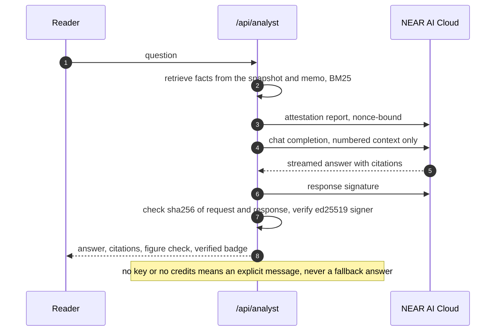

#  Valuo

**The long-term investment case for $NEAR, stated as conditions anyone can check against live mainnet data.**

Valuo is an Investment Committee (IC) terminal and a Python quant engine. It reads NEAR mainnet and NEAR Intents live, races NEAR Intents' 1Click router against Relay, LI.FI and Across on the same trades, values the cash flows NEAR holders can point to with a seeded 10,000-path Monte Carlo, and then inverts the model: what would each input have to be for the model to equal the market price? Everything is judged by one comparison: **what NEAR's market value requires vs what the live data shows today**, condition by condition, graded *on track*, *behind* or *against*.

Built for the NEAR Hackathon 2026, `[ 02 / INV ] Investment Thesis` track · Not investment advice · App: **[usevaluo.vercel.app](https://usevaluo.vercel.app)** · Demo: `<VIDEO_URL>` · Code: private until submission, access on request

**Judges, start here:** open [`/terminal#thesis`](https://usevaluo.vercel.app/terminal#thesis) for the bull-case scorecard (no wallet, no login), then [`/terminal?verify=rehash`](https://usevaluo.vercel.app/terminal?verify=rehash) to re-hash every stored source payload in your browser. To rebuild every number yourself: `make sync && make reproduce` (no API keys). A claim-by-claim checklist is in **[JUDGES.md](JUDGES.md)**.

---

## Seven sections, no wallet needed

| Section | What it is | Try it without a wallet |
| --- | --- | --- |
| **01 Thesis & evidence** | The **bull-case scorecard**: 8 conditions the long-term case needs (Intents volume growth, holder revenue, the L1 multiple, 1Click's pricing edge, confidential flow, net deflation, the 2.5% → 1.6% issuance cut, solver competition). Each shows the value it requires, the live value, a 90-day trend from a real series and a status. Below it: the reverse valuation and the evidence scorecard. | [`/terminal#thesis`](https://usevaluo.vercel.app/terminal#thesis) |
| **02 Execution alpha** | **Live quote race.** The same dry quote request goes to 1Click, Relay, LI.FI and Across at once, ranked on destination units delivered for the identical input, on cross-VM (`ETH USDC → SOL USDC`), native BTC and EVM L2 routes, at $500, $50,000 and $250,000. Nothing is signed or sent. | [`/terminal#execution`](https://usevaluo.vercel.app/terminal#execution) → **Run live quote race** |
| **03 Supply physics** | Issuance measured per epoch from `total_supply` jumps, against buybacks, L1 gas burn and NEP storage-staking locks (1 NEAR per 100 KB). Breakeven daily volume per issuance regime, and a **Chain Signatures** audit of `v1.signer` usage. | [`/terminal#supply`](https://usevaluo.vercel.app/terminal#supply) → toggle the regime |
| **04 SOTP & Monte Carlo** | Three-engine sum-of-the-parts (SOTP) valuation, 10,000 seeded paths (seed `20261114`), sliders that re-price client-side with the same formulas, a sensitivity tornado and peer multiples. **Publish your forecast** to NEAR from here (needs a wallet). | [`/terminal#sotp`](https://usevaluo.vercel.app/terminal#sotp) → move the sliders |
| **05 Bear case** | Four stress scenarios priced through the same model, each with a live early-warning trigger and threshold. A trigger that was not measured says so; it is never read as "not breached". | [`/terminal#bear`](https://usevaluo.vercel.app/terminal#bear) |
| **06 History** | Daily snapshots and hourly quote races as time series, plus an **out-of-sample backtest** of the volume model, including where it fails. | [`/terminal#history`](https://usevaluo.vercel.app/terminal#history) |
| **07 Ask the analyst** | Questions answered only from the hashed snapshot by a model on NEAR AI Cloud's attested private inference. Every sentence cites its source; numbers are checked against the context; the response signature is verified against NEAR AI's attestation report. *If it is not in the snapshot, the analyst says so.* | [`/terminal#analyst`](https://usevaluo.vercel.app/terminal#analyst) |

### More to explore

| Feature | What it is | Where |
| --- | --- | --- |
| **Verify sources** | Re-hashes every stored raw payload with WebCrypto in your browser, and "Fetch live and compare" re-issues a recorded request to show what changed since the snapshot. | header → **Verify sources**, or [`/terminal?verify=rehash`](https://usevaluo.vercel.app/terminal?verify=rehash) |
| **IC memo** | A 15-section Markdown memo generated from the snapshot. It opens with the falsifiable long-term case. | [`/api/snapshot?format=memo`](https://usevaluo.vercel.app/api/snapshot?format=memo) |
| **Snapshot JSON** | The full dataset the terminal renders, with the manifest. | [`/api/snapshot?format=json`](https://usevaluo.vercel.app/api/snapshot?format=json) |
| **Forecast board** | Every forecast published to NEAR SocialDB under `*/valuo/forecast/*`, read key-free and scored against later snapshots. | [`/terminal#sotp`](https://usevaluo.vercel.app/terminal#sotp), below **Publish your forecast** (click **Refresh** if it looks empty; the list is cached up to 30 s). Raw: [`/api/forecasts`](https://usevaluo.vercel.app/api/forecasts) |
| **Landing page** | The thesis in one page: what the price requires, the measured strengths and weaknesses, and the falsification triggers. | [`/`](https://usevaluo.vercel.app/) |

The terminal has a sticky left sidebar with count badges (bull-case conditions on track, bear triggers breached, history points) that collapses to its section numbers. On phones and tablets it becomes a left drawer opened by a burger button, every table scrolls inside its card, and inputs use 16 px text so iOS does not zoom. The header shows the snapshot's NEAR block, its time and how far it trails the live chain head.

## Why NEAR mainnet is essential

Without NEAR's public chain there is no evidence, only a narrative.

- **No mainnet, no supply physics.** Issuance, validators, storage locks and protocol limits are read from NEAR RPC at a recorded block (`quant/valuo/collectors/near_rpc.py`). Issuance is measured from `total_supply` jumps at epoch boundaries, not assumed from the 2.5% cap.
- **No `intents.near`, no forensics.** Solver concentration is decoded from `execute_intents` signer payloads, and the Confidential Intents treasury (an implicit account holding NEP-245 balances inside `intents.near`) is read directly for TVL and boundary flow (`quant/valuo/collectors/confidential_boundary.py`).
- **No 1Click, no pricing-power test.** The headroom figure only exists because NEAR Intents serves executable dry quotes that can be compared, unit for unit, with competitors (`quant/valuo/collectors/execution_bench.py`).
- **No SocialDB, no tamper evidence.** Each daily snapshot's hashes are written to `social.near`, and visitors' forecasts are written there too (`quant/valuo/anchor.py`, `web/src/lib/forecast.ts`). Anyone can read both back over public RPC.

## Architecture

Valuo has four layers:
- **The quant engine** (`quant/`, Python): collectors fetch and hash every response, models compute, and one command writes `artifacts/`.
- **The artifacts** (`artifacts/`): `latest_snapshot.json`, `manifest.json` (SHA-256 of every raw payload), `IC_MEMO.md`, raw payloads and the history store. The web app reads only these.
- **The web terminal** (`web/`, Next.js): renders the artifacts and runs the live checks (quote race, re-hash, refetch, analyst, forecasts).
- **The scheduler:** a VPS runs the daily snapshot and the hourly quote race, commits the results back to the repository and anchors each snapshot on NEAR.

Model design, field by field: **[docs/MODEL_DESIGN.md](docs/MODEL_DESIGN.md)**. Endpoint behaviour as probed: **[docs/LIVE_ENDPOINT_FACTS.md](docs/LIVE_ENDPOINT_FACTS.md)**. Scheduler: **[docs/VPS.md](docs/VPS.md)**.

### System overview



The engine is the only writer of `artifacts/`; the web app only reads them, so every number on screen traces to a hashed file. The live checks in the web app (quote race, refetch, forecast board, analyst) call public sources directly but never change the artifacts. The scheduler commits each run back to the repository, so the deployed site and the repository show the same snapshot.

### Who holds which key



| Key | Lives in | Can | Can never |
| --- | --- | --- | --- |
| Anchor account key | the VPS, `/home/valuo/.near-credentials/mainnet/` (mode 600) | write `valuo/snapshot/*` under its own SocialDB namespace, spend its own small balance | touch other accounts, user funds or any visitor's forecast |
| Visitor's wallet | the visitor's wallet app | write that visitor's own forecast | write under any other account (SocialDB only accepts writes to the signer's namespace) |
| `NEAR_AI_API_KEY` | server environment (`.env` locally, the host's env vars in production) | call NEAR AI chat completions | reach the browser; it is never logged or returned |
| GitHub deploy key | the VPS, `~/.ssh/valuo_deploy` | push to this one repository | access any other repository |

Collectors need no key at all. Optional keys (`ONECLICK_JWT`, `NEARBLOCKS_API_KEY`) only unlock confidential quotes or raise rate limits.

### The data pipeline

```mermaid
flowchart LR
  subgraph Collect["Collect, hash every response"]
    direction TB
    A1["near_rpc"]
    A2["execution_bench<br/>quote race"]
    A3["intents_forensics<br/>+ confidential treasury"]
    A4["comps<br/>peer fees, FDV"]
    A5["chain_signatures<br/>v1.signer"]
  end
  subgraph Model["Model"]
    direction TB
    B1["supply_physics"]
    B2["sotp_valuation<br/>10,000 paths"]
    B3["bear_case"]
  end
  subgraph Derive["Derived views"]
    direction TB
    C1["market_implied"]
    C2["sensitivity"]
    C3["relative_value"]
    C4["bull_case"]
    C5["backtest"]
  end
  subgraph Write["Write"]
    direction TB
    D1["latest_snapshot.json"]
    D2["manifest.json"]
    D3["IC_MEMO.md"]
    D4["history/"]
  end
  Collect --> Model --> Derive --> Write
```



Collectors run concurrently and every request goes through `valuo.provenance.fetch_json` or `near_rpc_call`, which store the exact response bytes under `artifacts/raw/` and record source, URL, SHA-256, size and fetch time in the manifest. A source that fails becomes a warning and a `null`; nothing is substituted. The derived views read only the snapshot, so they add no fetches.

### Daily run on the scheduler



An anchoring failure is logged and never fails the run; that snapshot is simply not anchored. The hourly job (`valuo-run.sh bench`) runs the quote race, re-hashes its stored payloads and commits `artifacts/history/`.

### Publishing a forecast



On an account's first SocialDB write the deposit is SocialDB's minimum storage balance (0.02 NEAR) plus about 0.01 NEAR; later writes attach about 0.01 NEAR. Forecasts are scored against the price in later snapshots once their horizon passes.

### Asking the analyst



The default model is `deepseek-ai/DeepSeek-V4.1-Flash-1017`, served by NEAR AI from attested TEE (trusted execution environment) hardware. "Verified by NEAR AI attestation" appears only when the signed hashes match the exact bytes sent and received and the signer is in the attestation report. The hardware quotes inside that report are not re-verified locally.

### Getting started

```mermaid
flowchart LR
  subgraph Read["Read and verify, no wallet"]
    direction LR
    S1["Open /terminal"] --> S2["Bull-case scorecard"] --> S3["Run the quote race"] --> S4["Verify sources"]
  end
  subgraph Rebuild["Rebuild, no keys"]
    direction LR
    R1["make sync"] --> R2["make reproduce"] --> R3["make test"] --> R4["make anchor-verify"]
  end
  subgraph Commit["Commit a view, wallet"]
    direction LR
    F1["Connect wallet"] --> F2["Publish forecast"] --> F3["See it on the board"]
  end
  Read --> Rebuild --> Commit
```



### One real run, end to end

On 2026-11-10 the scheduler's account anchored the 13:04 UTC snapshot (manifest of 134 hashed records, NEAR block 223,919,878) on NEAR mainnet in transaction [`7fZ41XeD…`](https://nearblocks.io/txns/7fZ41XeDrCAjzN2ig7YTP7e3hPZz218Bns2KiiUkLPyy), written at block 223,920,960. Checked from a separate machine with `make anchor-verify ANCHOR=0161aff7…81f0`: every hash matched. The anchor account is [`0161aff7…81f0`](https://nearblocks.io/address/0161aff765e5412f3d3cac430933fb44325b5b012cf525410a9c7d1fa2fa81f0).

**A visitor forecast, end to end.** On 2026-11-11 the account [`bigmantech001.near`](https://nearblocks.io/address/bigmantech001.near) published a forecast from its own wallet through **Publish your forecast**: transaction [`3ZqwUprY…`](https://nearblocks.io/txns/3ZqwUprYywZuJ6puotb7mK9zHBTKmKnM3aQaTWwmpU2y), SocialDB key `bigmantech001.near/valuo/forecast/20261111T045413Z`, written at block 224,018,870 (5.5 Tgas, 0.03 NEAR storage deposit). It shows on the board at [`/terminal#sotp`](https://usevaluo.vercel.app/terminal#sotp) (scroll below **Publish your forecast**) as "On-chain", and in [`/api/forecasts`](https://usevaluo.vercel.app/api/forecasts).

---

<!-- VALUO:FINDINGS:START -->
## Findings as of the committed snapshot (NEAR block 224,026,014, 2026-11-11T06:05:00.892Z UTC)

Generated by `python -m valuo.reproduce` from `artifacts/latest_snapshot.json` (SHA-256 `bfea7b9118863c7c0adcc7399b3dad4bbdf70c006dd3e11d0d118735d3eaa96c`, 2026-11-11T06:05:03.180Z UTC, valuo 0.1.0). Every figure is a live fetch, an arithmetic derivation or a labeled assumption; `n/a` means the source was unavailable in this run and nothing was substituted. `make reproduce` regenerates this block.

| Finding | Value | Basis |
| :--- | :--- | :--- |
| NEAR block / total supply | 224,026,014 / 1,311,395,122 NEAR | RPC `block` header at 2026-11-11T06:05:00.892Z |
| Market FDV vs model (expected path / MC P50) | $4.80B vs $775.4M / $248.1M (market = 6.2x the expected path) | model capitalises Intents holder revenue + gas burn + state lock, 36 m, 25% discount, 60x terminal cap |
| What the market FDV requires (one input at a time) | expected volume growth 167.2% (evidence 20.8%; outside); starting public take 183.52 bps (evidence 3.00 bps; outside); terminal multiple 396x (evidence 2,411x; inside) | brentq solve on the expected path, others at base; evidence = trailing-12m Intents volume growth, live competitive fee ceiling, peer median FDV/revenue (`market_implied`) |
| Relative value: FDV / annualised fees | NEAR 70x vs peer median 253x; rank 2 of 4 (lowest first, inside the peer range) | peer-multiple band $10.76B-$43.75B is a cross-check, not a fair value; n = 3 peers (`relative_value`) |
| Top FDV drivers (tornado) | public_volume_growth_yoy $241.4M-$4.04B; terminal_multiple $153.3M-$1.85B; fee_compression_lambda_monthly $283.7M-$1.25B (91% of swing-squared variance) | 17 inputs at registry / measured ranges; 0 reach the market FDV (`sensitivity`) |
| Protocol inflation cap / measured issuance | 2.50% cap; measured 32,755,060 NEAR/yr = 2.498% (89,678 NEAR/day) | `EXPERIMENTAL_protocol_config`; total_supply jumps at epoch starts |
| Validators / staked ratio | 351 / 44.39% (582,122,256 NEAR) | RPC `validators` |
| intents.near NEP state lock | 13,566,758,299 bytes = 135,668 NEAR locked; growth 296.4 NEAR/day over 30.9 d | `view_account` + storage_amount_per_byte (0.01 NEAR/KB); archival lookback for growth |
| NEAR Intents 30d volume (public / confidential) | $3.76B (n/a / n/a; confidential share 40.0%) | confidential share status `implausible_fallback`: NOT MEASURED; assumption: registry confidential_share = 40% (nearstats split implausible; not a measurement) |
| Gross take / net take / capture ratio | 14.53 bps / 4.83 bps / 33.3% | ONE canonical window: aligned daily charts, 30 complete UTC days 2026-10-12..2026-11-10 |
| Daily sinks vs issuance | buyback 16,532 NEAR + gas burn 851 NEAR + state lock 332 NEAR = 19.8% of 89,678 NEAR/day | supply_physics; buyback = V x tau x alpha / P |
| Breakeven daily volume V* (status quo / SVRN glidepath) | $670.5M / $425.9M per day (today $125.3M/day) | V* = (I - G - L) x P / (tau x alpha) at the regime's terminal rate |
| Live quote race, 1Click headroom vs best competitor (destination units) | ETH USDC -> SOL USDC: +0.98 bps median over 3 cells; ETH USDC -> native BTC: -14.25 bps median over 3 cells; Base USDC -> Arbitrum USDC: -1.02 bps median over 3 cells | 1Click vs Relay / LI.FI / Across at $500, $50,000, $250,000; competitor ceiling 3.00 bps on cross-VM; 2026-11-11T06:05:10.558Z |
| Deposit/caller HHI / solver HHI on intents.near | 2,219 (bootstrap 90% CI 1,403-3,265) / 4,876 (bootstrap 90% CI 3,878-5,322) (77 fill participations over 29,003 s); cartel trigger breached | NearBlocks receipts: 185 over 8 pages; AI-agent (name-pattern) share 42.9% |
| SOTP FDV P10 / P50 / P90 (36 m, discounted) | $54.0M / $248.1M / $1.57B vs current FDV $4.80B (-94.8% at P50) | 10,000 paths, seed 20261114; terminal multiple 60.0x (derived); deterministic (expected-path) FDV $775.4M |
| Bear case, combined worst (deterministic, median inputs) | $104.1M (-87%); triggers breached 2 of 4 measured | four falsification scenarios through deterministic_sotp; live early-warning metrics |
| Evidence scorecard | ASSUMPTION 1, DERIVED 2, NOT_SUPPORTED 2, VERIFIED_LIVE_API 4, VERIFIED_ON_CHAIN 3 | 12 graded claims in `IC_MEMO.md` section 12 |

15 methodology warning(s) recorded in this run; see `IC_MEMO.md` section 15.1.
<!-- VALUO:FINDINGS:END -->

---

## Safety and trust model

- **Nothing moves money.** Every quote in the race is a dry quote (`"dry": true` on 1Click); nothing is signed or deposited. The only transactions Valuo sends are SocialDB writes from the anchor account, and the only ones visitors send are their own forecast writes, approved in their own wallet.
- **The server never holds a visitor key.** Forecasts are signed in the visitor's wallet through NEAR Wallet Selector, with no function-call access key created for the app (`web/src/lib/nearWallet.ts`).
- **The anchor key signs locally and checks itself.** `valuo.anchor publish` builds the transaction in Borsh, signs its SHA-256 with ed25519 through the system `openssl`, verifies the signature before sending, and reads the key from a mode-600 file that never leaves the VPS (`quant/valuo/anchor.py`).
- **Rate limits on every public route** (in memory, per instance): `/api/analyst` 10 questions per IP and 60 overall per minute; `/api/refetch` 20 per IP per 5 minutes; `/api/forecasts` 30 per IP per 5 minutes; `/api/live-benchmark` 60 per IP per 5 minutes; `/api/raw` 300 per IP per 5 minutes. `/api/refetch` only re-issues requests to an allow-list of the recorded hosts, and rebuilds NEAR RPC bodies only when they hash to the recorded request.
- **User-written data is untrusted.** Forecasts read from SocialDB are length-capped, numbers are coerced, malformed entries are dropped and counted, and nothing is rendered as HTML. Text inside analyst context items is passed to the model as data, not instructions.
- **The scheduler cannot hurt its host.** On a shared server the jobs run as an unprivileged `valuo` user inside a systemd scope (`MemoryMax=768M`, low CPU and IO weight); a runaway run is killed instead of competing with other services (`ops/vps/install-shared.sh`).
- **The in-browser reproduce button is off by default** (`VALUO_ALLOW_REPRODUCE`), so a public deployment cannot be made to spawn the pipeline.
- **Tests:** 345 passed, 5 skipped (the skipped ones are live-network tests, run with `VALUO_LIVE_TESTS=1`), `make test`, 2026-11-10.

## What is measured, derived, assumed or simulated

| Measured live (hashed) | Derived, assumed or simulated (labelled as such) |
| --- | --- |
| NEAR supply, protocol config, validators, storage locks, per-epoch issuance (NEAR RPC) | The 10,000-path Monte Carlo and the SOTP value: a model, seeded, not a forecast of price |
| Executable dry quotes from 1Click, Relay, LI.FI and Across | 39 labelled assumptions (discount rate, terminal multiple cap, growth path, bear stresses...), each with a range in `IC_MEMO.md` |
| Intents volume, fees, holder revenue (DefiLlama), price (CoinGecko via nearstats) | Confidential share of volume: the last plausible nearstats split (40%) while the live split is broken; an on-chain treasury-inflow proxy is shown next to it |
| Solver and caller concentration from `intents.near` receipts (NearBlocks), with bootstrap 90% confidence intervals | Confidential take rate: an assumption unless a 1Click partner key (`ONECLICK_JWT`) lets the race price confidential quotes |
| Confidential Intents treasury TVL and 30-day net flow (`intents.near` balances) | Bull-case requirements: one input moved at a time until the model equals the market value; each says what that condition alone must deliver |
| Chain Signatures usage, sampled from NearBlocks pages | The backtest: the volume model re-run at past dates on data available then; it under-predicts at 3 and 6 months and says so |
| Snapshot hashes on NEAR (SocialDB) | Forecast scores: a forecast is scored against the latest snapshot price once its horizon has passed |

## Tech stack

Python 3.11+ with `uv`, `httpx`, `pydantic` v2, `numpy`, `scipy`, `duckdb`, `pytest` · Next.js 15.5 (App Router), React 19.1, TypeScript 5, Tailwind CSS 4, hand-rolled SVG charts · NEAR Wallet Selector 10.1 (MyNearWallet, Meteor, HERE, Intear) · NEAR AI Cloud (OpenAI-compatible API, default `deepseek-ai/DeepSeek-V4.1-Flash-1017`) · Data: FastNEAR RPC (mainnet and archival), 1Click, Relay, LI.FI, Across, NearBlocks, nearstats, DefiLlama, CoinGecko, `api.near.social` indexer · Scheduler: cron on Ubuntu 24.04, systemd scopes.

## Run it locally

**Prerequisites:** Python 3.11+ with [uv](https://docs.astral.sh/uv/), Node 20+, `make`, and `openssl` 3 (only for publishing anchors).

```bash
make sync          # cd quant && uv sync
make reproduce     # live mainnet + quote race + forensics -> 10,000-path Monte Carlo -> artifacts/ (about 8 minutes)
make test          # unit tests + invariant checks against artifacts/
shasum -a 256 artifacts/latest_snapshot.json   # must equal manifest.json: snapshot_sha256
cd web && npm install && npm run dev            # http://localhost:3000, reads ../artifacts
```

| Command | What it does |
| --- | --- |
| `make reproduce-fast` | smoke run (no quote race, 2,000 paths) into `artifacts/dev/`; never touches the canonical files |
| `make bench-history` | one live quote race into `artifacts/history/bench.jsonl`, raw responses gzipped and hashed |
| `make history-verify` | re-hash every raw payload referenced by the history store |
| `make anchor-verify ANCHOR=<account>` | compare your `manifest.json` with the hashes anchored on NEAR (no key) |
| `make anchor-list ANCHOR=<account>` | list every anchored snapshot and its write block |

Everything works without a `.env`. Copy `.env.example` to `.env` at the repo root to change anything:

| Variable | What it does | Default / when unset |
| --- | --- | --- |
| `NEAR_RPC_URL`, `NEAR_RPC_FALLBACK_URL`, `NEAR_ARCHIVAL_RPC_URL` | NEAR RPC endpoints | FastNEAR free RPC, then `rpc.mainnet.near.org`; FastNEAR archival |
| `ONECLICK_JWT` | 1Click partner token; enables the confidential-quote check | unset: confidential take stays a labelled assumption |
| `NEARBLOCKS_API_KEY` | raises NearBlocks rate limits | unset: calls are spaced to the free tier |
| `VALUO_MC_SEED`, `VALUO_MC_PATHS`, `VALUO_HORIZON_MONTHS` | Monte Carlo settings | `20261114`, `10000`, `36` |
| `VALUO_ARTIFACTS_DIR` | where artifacts are written and read | `<repo>/artifacts` |
| `NEAR_AI_API_KEY` | server-side key for the analyst | unset: the analyst says NEAR AI is not configured and answers nothing |
| `NEAR_AI_MODEL` | analyst model id | `deepseek-ai/DeepSeek-V4.1-Flash-1017` |
| `VALUO_ALLOW_REPRODUCE` | enables the in-browser reproduce button | `0` (off) |
| `VALUO_ANCHOR_ACCOUNT` | scheduler only: NEAR account that anchors snapshots | unset: no anchoring |

**Test status (2026-11-10):**

```
345 passed, 5 skipped
```

## Deploying

1. **Web.** Import the repository into Vercel with **Root Directory** `web`. The `prebuild` step copies `../artifacts` into `web/.valuo-data`, so the deployed site serves the committed snapshot. Set `NEAR_AI_API_KEY` as an environment variable for the analyst; leave `VALUO_ALLOW_REPRODUCE` unset. With Vercel's Git integration on, each data commit the scheduler pushes redeploys the site.
2. **Scheduler.** On a Debian or Ubuntu server, follow [docs/VPS.md](docs/VPS.md): a job user with a GitHub deploy key, `make sync`, then `ops/vps/setup.sh` (dedicated server) or `ops/vps/install-shared.sh` (server shared with other services). It installs `5 6 * * *` (daily snapshot) and `23 * * * *` (hourly quote race), UTC.
3. **Anchoring (optional).** Fund a NEAR account (an implicit account works), put its key in `~/.near-credentials/mainnet/<account>.json` on the VPS, and re-run the installer with `VALUO_ANCHOR_ACCOUNT=<account>`. Each anchor attaches about 0.01 NEAR for SocialDB storage.
4. **First live runs.** The hourly race first ran and pushed on its own at 2026-11-10 12:23 UTC. The first anchor is transaction [`6ZPRJLh8…`](https://nearblocks.io/txns/6ZPRJLh8mCBTBZXquqA4WFP5mL384u3z3dbNqXt5vwhk) (block 223,914,397).

## Repository map

```
Valuo/
├── README.md, JUDGES.md          this file; the judges' claim-by-claim checklist
├── Makefile                      reproduce, test, history, anchor targets
├── .env.example                  every optional setting, all key-free by default
├── artifacts/                    written by quant, read by web
│   ├── latest_snapshot.json      the canonical dataset
│   ├── manifest.json             SHA-256 of every raw payload and of the snapshot
│   ├── IC_MEMO.md                the generated Investment Committee memo
│   ├── raw/                      exact response bytes behind every number
│   └── history/                  daily snapshots and hourly quote races
├── quant/
│   ├── valuo/collectors/         near_rpc, execution_bench, intents_forensics,
│   │                             confidential_boundary, comps, chain_signatures
│   ├── valuo/models/             supply_physics, sotp_valuation, bear_case, bull_case,
│   │                             market_implied, sensitivity, relative_value, backtest
│   ├── valuo/provenance.py       fetch, hash and record every response
│   ├── valuo/assumptions.py      the labelled assumption registry with ranges
│   ├── valuo/anchor.py           SocialDB anchoring: build, sign, send, verify
│   ├── valuo/history.py          the time-series store
│   ├── valuo/memo_generator.py   IC_MEMO.md and the README findings block
│   ├── valuo/reproduce.py        the one-command pipeline
│   └── tests/                    unit tests and invariants
├── web/src/
│   ├── app/                      / (landing), /terminal, api/ (snapshot, raw, refetch,
│   │                             live-benchmark, forecasts, analyst, reproduce)
│   ├── components/               landing, tab1..tab6 sections, analyst, provenance, ui
│   └── lib/                      snapshot loading, verification, forecasts, wallet, analyst
├── ops/vps/                      valuo-run.sh, valuo.crontab, setup.sh, install-shared.sh
└── docs/                         MODEL_DESIGN.md, LIVE_ENDPOINT_FACTS.md, VPS.md
```

`QUANT_PIPELINE_SPEC.md` and `TERMINAL_UI_SPEC.md` are the original pre-build briefs, kept for the record; where they differ from the artifacts, the artifacts are right.

## Pre-existing work and credits

- **No prior Valuo code.** Everything in `quant/` and `web/` was written for this hackathon.
- **Libraries:** Next.js and React, NEAR Wallet Selector (wallet signing), the Python scientific stack (numpy, scipy), pydantic, httpx, DuckDB.
- **Reference material:** NEAR's public agent skills (`github.com/near/agent-skills`) were read during the build; they are not part of this repository.
- **Data and APIs:** NEAR mainnet RPC (FastNEAR), NEAR Intents 1Click, Relay, LI.FI, Across, NearBlocks, nearstats.org, DefiLlama, CoinGecko, the NEAR Social indexer, NEAR AI Cloud. Third-party figures are shown as reported by those sources and hashed as received.
- **Contracts:** Valuo deploys none. It writes to the existing `social.near` (SocialDB) contract and reads `intents.near` and `v1.signer`.

## License

[MIT](LICENSE).

---

*Valuo is research software. Nothing here is investment advice; model outputs are not price targets, and every assumption is labelled with its range.*
